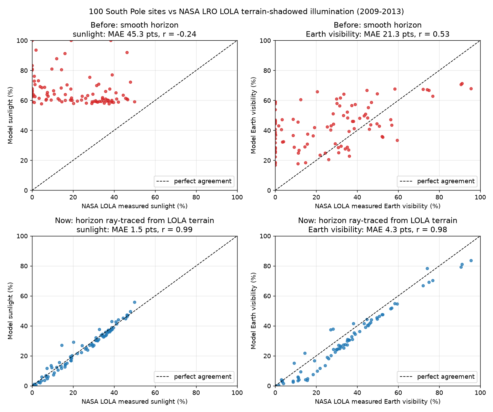

# Lunar Landing Site Navigator

**NASA Space Apps 2026 · Team TNB** — a decision-support tool that ranks candidate landing sites at the lunar South Pole
(−85° to −90°) by combining terrain safety, real terrain-shadowed sunlight and Earth line-of-sight, in an interactive
true-scale 3-D mission-control dashboard.



## What it does
- **Click anywhere on the 3-D Moon** (NASA LRO imagery, true-scale Earth and Sun) to evaluate that exact point.
- **Site Suitability Score** (0–100) with a GO / CONDITIONAL / Unsafe for Landing (High Risk) verdict, 95% confidence interval and an **Evidence** card listing every safety check against its limit.
- **Real terrain horizons:** each point's horizon is ray-traced in 720 directions over NASA's LOLA polar terrain; validated independently against NASA's illumination maps (sunlight error 1.5 points, r = 0.99).
- **60-day mission timeline** with live sunrise / Earthrise countdowns, solar power, and a **battery survival** check through the longest night.
- **Suitability heatmap**, named craters (IAU), top-3 landing windows, top-5 backup sites, side-by-side comparison, CSV export.
- **Hardware what-if:** tower height (1–150 m) instantly re-computes the exact horizon (dip and line-of-sight distance) and shows its effect on sunlight, Earth contact and slope; panel tilt and area update power; "Map for my hardware" recolours all 100 sites for your tower and battery.

See [docs/JUDGES_BRIEF.md](docs/JUDGES_BRIEF.md) for the method, validation results and limits.

## Quick start
Requirements: Python 3.10+, Node.js 20+.

```bash
pip install -r requirements.txt
python src/analysis/nasa_data.py                  # optional: unpacks the bundled NASA LOLA data (also happens automatically on first use)
uvicorn src.app.api_server:app --port 8000        # backend  -> http://localhost:8000/docs
```

```bash
cd frontend
npm install
npm run dev                                       # frontend -> http://localhost:5173
```

The frontend falls back to a built-in offline engine if the backend is unreachable. API reference: [API_USAGE.md](API_USAGE.md).

## How it works
| Step | Data / method |
|---|---|
| Terrain | Slope, elevation, roughness from the NASA LRO **LOLA** elevation model (118 m/px) |
| Sun and Earth positions | Hourly ephemeris from **JPL Horizons** (analytic fallback offline) |
| Terrain shadowing | Horizons ray-traced over the LOLA **LDEM_75S_120M** polar elevation model; calibrated to NASA LOLA **average visibility maps** (60 m/px, 2009–2013) |
| Score | Gradient-boosting model on 100 sites (5-fold CV error ≈ 3.6 / 100, R² 0.96) + rule-based components |
| Safety | 3-layer safety factor (13.5° derated slope, worst-case score buffer, hazard probability < 28%) + hard guardrails |

## Tests and validation
One command runs every suite below and the NASA benchmark, prints a table, lists any failing check, and writes
`outputs/test_summary.json` (shown as the "VALIDATED n/n checks" badge in the dashboard header via `GET /api/validation`):
```bash
python tests/run_all.py                     # everything: 392 checks
```
Individual suites:
```bash
python tests/test_all.py                    # 100 cases: data integrity, physics, safety rules, API, input validation, app/backend parity
python src/app/api_selftest.py              # 107 API checks with independently recomputed expectations
python src/analysis/test_tower_limit.py     # tower-height physics (1-150 m)
python tests/test_verdict_rules.py          # 32 checks: mast never downgrades a verdict, 5.0 deg Optimal rule, tower/battery safe-zone map
python tests/test_edge_cases.py             # 102 checks: boundary limits, malformed input, mode consistency, tower propagation, front-end error handling
python src/analysis/nasa_benchmark.py       # 23 checks against NASA / JPL reference data (terrain, illumination, ephemeris, constants, physics)
python src/analysis/validate_illumination.py  # comparison with NASA LOLA illumination maps
```

## Project structure
```
src/analysis/   computation: ephemeris, terrain shadowing, scoring, ML training, validation (no UI code)
src/app/        FastAPI backend (api_server.py) and its self-test
frontend/       React + three.js dashboard (see frontend/README.md)
tests/          100-case data and system test suite
scripts/        data preparation (NASA Moon textures, app site list)
models/         trained models          outputs/   rankings, metrics, figures, reports
nasa_data/      bundled NASA LOLA rasters (DEM + Sun/Earth illumination maps), losslessly packed, SHA-256 verified
ephemeris_cache/ JPL Horizons Sun/Earth series for the 100 sites (offline)
data/           unpacked working copies (git-ignored; created automatically from nasa_data/)
docs/           judges' brief
```

## Data sources
NASA LRO LOLA elevation models (USGS LDEM 118 m; PDS LDEM_75S_120M polar) · NASA PDS LOLA illumination products (AVGVISIB_85S_060M) · JPL Horizons ephemeris ·
NASA SVS CGI Moon Kit (LROC colour, LOLA elevation) · IAU Gazetteer of Planetary Nomenclature (crater positions).

## Limits
Horizons use 120 m/px terrain (smaller features unresolved); the all-sites hardware map uses a uniform-dip approximation for the mast (single-site results re-ray-trace it); the heatmap is
interpolated from 100 scored sites. This is a screening tool, not a certified landing-site analysis.
