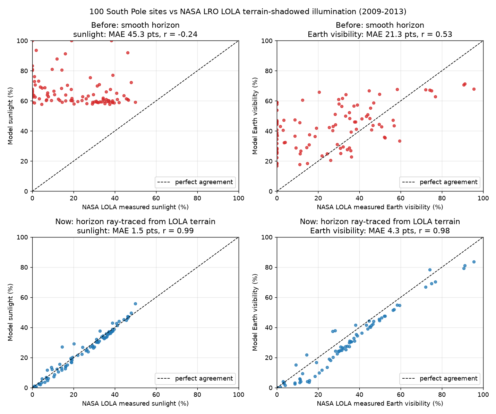

# Lunar Landing Site Navigator — Judges' Brief
**NASA Space Apps 2026 · Team TNB · Lunar South Pole (−85° to −90°)**

## The problem
Artemis is going to the lunar South Pole for water ice. The terrain there is steep, the Sun barely clears the horizon,
and Earth often drops out of view. A good landing site has to be flat enough to land on, lit long enough to power the
lander, and in view of Earth often enough to talk to it. Our tool scores all three, for any point, at any time.

## What it does
| Feature | What you see | Why it matters |
|---|---|---|
| **Real NASA Moon** | 3-D Moon at true scale (Moon, Earth and Sun at real sizes and distances), textured with NASA's CGI Moon Kit (LRO LROC colour + LOLA elevation) | Planners see the real South Pole, not an artist's sphere |
| **Click anywhere** | Any point in the cap is evaluated live at its exact coordinates | Not limited to a preset list |
| **Landing decision** | Score 0–100, GO / CONDITIONAL / NO-GO, 95% confidence interval | One clear answer, with its uncertainty |
| **Evidence card** | Every safety check, with the measured value next to its limit | Judges and planners can audit *why* — no black box |
| **Suitability heatmap** | Whole cap coloured by score (green = better), updates with the priority mode | The best regions are visible at a glance |
| **Named craters** | Shackleton, de Gerlache, Haworth, Faustini, Nobile, Malapert… (IAU coordinates) | Several Artemis III candidate regions are named after these features |
| **Mission timeline** | Sun and Earth move hour by hour over 60 days, with live countdowns to sunrise and Earthrise | Landing timing matters as much as location |
| **Power survival** | Battery charge simulated through the longest lunar night, plus the minimum battery needed | Answers "will the lander survive the night?" |
| **Hardware what-if** | Tower height (1–150 m), panel tilt and area update power instantly | A taller mast sees over the horizon: 150 m gains 0.75° of Sun elevation |
| **Map for my hardware** | Tick "Map for my hardware": all 100 sites are re-evaluated with your tower height, panels and battery; pins and heatmap recolour, with a live count of green / conditional / NO-GO sites | Shows how hardware choices change where you can safely land: a bigger battery or taller mast turns sites green |
| **Compare + export** | Side-by-side comparison of two sites; CSV mission summary | Ready for a planning review |

## How it works
1. **Terrain:** slope, elevation and roughness from the NASA LRO **LOLA** digital elevation model.
2. **Sun and Earth:** hourly positions from **JPL Horizons** (Sun = 10, Earth = 399, seen from the Moon = 301), with a calibrated analytic fallback when offline.
3. **Real terrain horizons:** for every point we ray-trace the horizon in **720 directions** over NASA's LOLA south-polar
   elevation model (LDEM_75S_120M, 120 m/px, out to 250 km, Moon's curvature included). Each hour the Sun and Earth count
   as visible only if they are above the horizon *in their own direction* — so crater walls, ridges and distant massifs
   shadow a site exactly when the Sun is behind them. A small per-site offset (median 0.25° for the Sun) then aligns the
   long-run average with NASA's illumination map. Sunlight, power, battery, countdowns and the verdict all follow.
4. **Machine learning:** a model trained on the 100 sites (terrain-shadowed features) predicts the suitability score
   (gradient boosting; 5-fold cross-validated error **≈ 3.6 points** out of 100, R² = 0.96).
5. **Three-layer safety factor.** A site is NO-GO if any layer fails:
   - Slope must be under the lander limit minus a 1.5° margin (15° → **13.5°**), including a roughness allowance.
   - The *worst-case* score (95% lower bound) must clear the acceptance threshold plus a 3-point buffer.
   - The model's probability of "hazardous" must be under **28%**.
   - Hard rules also force NO-GO for sunlight below 25% of the time, Earth contact below 10%, or slope above 15°.
6. **Priority modes** (Most Safety / Balanced / Most Power) re-weight terrain, solar and comms, but **never relax the safety verdict**.

## Why you can trust the numbers
- **100-case data and system suite** passes: dataset integrity, derived-file consistency, physics, safety rules, API, input validation, and browser-vs-backend parity.
- **107 automated API checks** pass; each recomputes the expected value independently (including terrain shadowing).
- **32 verdict-rule checks** pass: a taller mast never downgrades a verdict or triggers an out-of-range warning, GO / Optimal needs slope ≤ 5.0° at every tower height, and battery / tower effects on the map behave monotonically. (Switching the fixes off makes 6 of them fail.)
- **23 tower-range checks** pass: the horizon gain matches the exact geometry (acos(R/(R+h))), sunlight never decreases with height, and the verdict is never degraded by a taller mast.
- The **offline engine** in the browser mirrors the backend, so the app works without internet.
- Out-of-range inputs are flagged ("outside model training range") instead of silently extrapolated.

## Validation against real NASA measurements
We test our sunlight and Earth visibility against NASA LRO LOLA **terrain-shadowed illumination maps** (60 m/px, 2009–2013),
an independent NASA product (`python src/analysis/validate_illumination.py`). Map reading was verified first: six known
permanently shadowed craters (Shackleton, Haworth, Faustini…) all read 0% sunlight.

| 100 sites vs NASA | First model (smooth horizon) | Now: horizons from LOLA terrain only (independent) |
|---|---|---|
| **Sunlight** average error | **45 points** (r = −0.24) | **1.5 points** (r = **0.99**), 99/100 sites within 10 points |
| **Earth visibility** average error | 21 points (r = 0.53) | **4.3 points** (r = 0.98) |

The "now" column uses **no NASA illumination input** — only terrain heights and Sun/Earth geometry — so it is a genuine
independent test. (The small calibration offset is applied afterwards for scoring.)

**What changed in the results:** the first model gave every site ~60% sunlight because it could not see crater walls.
With real horizons the picture is honest: **3 Optimal, 48 Acceptable, 49 NO-GO** sites for the mission window. The best
sites hold up — **Auto_SP_075** (60% Sun, 85% Earth, 4.8° slope) and **Auto_SP_099** (48% Sun, 56% Earth, 3.0° slope).
Shackleton's floor reads 0% sunlight and NO-GO, even with a 150 m mast. NASA's brightest spot near Shackleton's rim
(−89.475°, 222.56°E) gets ~100% sunlight in this window but is NO-GO because the rim is too steep — the real trade-off.

**Seasons are now captured:** our window (Nov 2026 – Jan 2027) is South-Pole summer (the Sun ~1.3° south of the lunar
equator), so sites average 29% sunlight in the window versus NASA's 21% four-year average. A single fixed horizon could not show this.

## Honest limits
- The hardware map uses the same rules as the offline engine (rule-based stand-in): it agrees with the full model on 97 of 100 sites at a 5 m mast and 88 of 100 at 150 m, never calls a NO-GO site green, and every full-model green site is green on the map.
- Horizons come from a **120 m/px** terrain model: features smaller than ~120 m (boulders, small ridges) are not resolved.
- The mast's benefit is approximated as a uniform horizon dip (acos(R/(R+h))), not re-ray-traced at mast height.
- Earth visibility is ~3.5 points low on average versus NASA (simplified libration model); the calibration offset corrects the average.
- The heatmap is **interpolated** from 100 scored sites. Only clicked points get a full evaluation.
- Terrain for custom points comes from a **118 m/px** elevation model; a 20 m/px polar model would resolve smaller hazards.
- Crater names mark crater **centres**, not NASA's exact Artemis III region boundaries.

## Next steps
Re-ray-trace horizons at mast height · 20 m/px terrain near the site · JPL Horizons azimuths for every hour · water-ice proximity (permanently shadowed regions) · landing-ellipse scoring · traverse planning.
